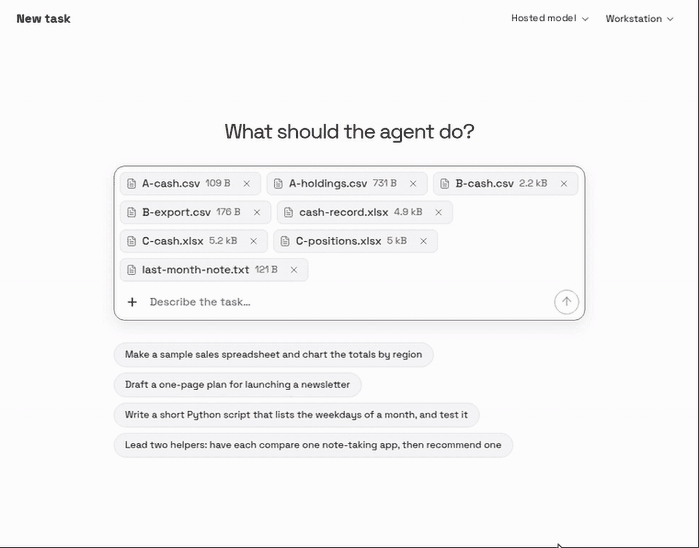

# TensorQuay Agent

**A self-hosted AI agent server: every task gets its own sandboxed computer, with local or cloud models.** For a
team sharing one machine, or one person with their own files and hardware. Rust, TypeScript, Apache-2.0.



*A task on a test install: three banks' exports (fictional) in, a checked holdings report and a list of cash differences
out. A hosted model; local models work the same way. Sped up.*

## Quick start

From a release, not `main`. Linux, or a Mac with Docker Desktop; Docker Engine 27.4 and Compose 2.31 or newer.

```sh
git clone --branch v18.0.0 https://github.com/TensorQuay/tensorquay-agent.git && cd tensorquay-agent
deploy/pull-images.sh   # pulls the release's prebuilt images (amd64 and arm64) and prints the lines the install needs
```

Then choose the settings, create the installation and start it: steps 1 to 3 of the
[install guide](deploy/README.md#install), about 10 minutes. Then open the page, create the
[first administrator](deploy/README.md#first-administrator-route-and-task) and start a task. No model server yet?
The guide's `--fake-model` builds a scripted one, enough to see a task run end to end.

## What it does

- **Each task in its own sandbox, on your files.** You describe the task; the agent reads, edits, runs commands and
  browses inside a sandbox of its own, on a workspace you keep, copy and share ([Tasks](docs/user-guide/tasks.md),
  [Workspaces](docs/user-guide/workspaces.md), [Sharing](docs/user-guide/sharing.md)).
- **Reads PDFs and pictures.** A PDF in the workspace is read page by page with the same file tool as everything else;
  a model that reads pictures is shown the pages, and the pictures, too
  ([Files, changes and context](docs/user-guide/files-and-changes.md#browse-the-workspace)).
- **Uses a desktop, and you can take over.** A task can run on a screen with a browser, a terminal and an office
  suite. You watch, take over to sign in somewhere, hand back, and replay what the agent did
  ([The desktop](docs/user-guide/desktop.md#take-over-and-hand-back)).

- **Previews a site with its folder.** A page the agent built shows in the Files panel with its style sheets, scripts
  and images, still sandboxed
  ([A web page with its folder](docs/user-guide/files-and-changes.md#a-web-page-with-its-folder)).
- **Local models first.** Any model server with the common chat-completions API, on your machine or hosted; prompt
  caching, a fallback for models with weak tool calling, budgets sized for small context windows
  ([Models](docs/admin-guide/web-settings.md#models);
  [Running without a GPU](docs/user-guide/tasks.md#running-without-a-gpu)).
- **For administrators: people, models and the network allow-list.** Accounts and roles, model routes with their
  keys, and the sites a sandbox may reach, with the ones it refused lately and Allow this site
  ([People](docs/admin-guide/web-settings.md#people),
  [Internet access](docs/admin-guide/web-settings.md#internet-access)).
- **Agent teams, experimental and off by default.** A task can lead helpers for work that splits; an administrator
  turns it on ([Helpers](docs/user-guide/helpers.md)).

## How it fits together

```text
browser ── HTTPS: events streamed down, actions posted up ──► tqa-gateway ──► PostgreSQL (history, users, usage)
                                                                  │
                                           outbound WebSocket     │   model calls through the gateway relay
                                                                  ▼
                                         sandbox: tqa-runtime (agent loop and tools) on /workspace
```

The gateway is the only public address. Each task gets its own sandbox on its own network, which dials out to the
gateway and has no other route: sandboxes cannot reach each other. Model credentials stay in the gateway. The
details are in [ARCHITECTURE](docs/ARCHITECTURE.md).

- **Multi-user on one box:** accounts, roles, persistent tasks, one sandbox per task, resume after disconnects and
  restarts.
- **Two runtime modes behind one interface:** `docker` (default; Docker Engine or Docker Desktop) and `firecracker`
  (KVM microVMs on a Linux host). Same image, same protocol, same tests.
- **Models through the gateway:** a local server such as vLLM, SGLang or TensorQuay Engine, or a hosted provider,
  over the common chat-completions API. The keys stay in the gateway's encrypted store and never enter a sandbox.
- **Isolation by design:** inside its sandbox the agent works freely; the network allow-list is the guardrail, and a
  refused connection names its host and port (ADR-0035). Workspaces are directories or block images on the host's
  own disk, mapped into the sandbox: no object storage in the file path.
- **Minimal core, open extension points:** skills, MCP tools inside the sandbox, connectors as gateway-proxied MCP
  servers, agent profiles, environments and model routes; channels, where agents and people post, propose and vote.

**Why another harness?** The existing ones are a CLI on one laptop, a hosted service, or a chat window without a
workspace. A team sharing one GPU workstation needs a server that gives every person a sandboxed agent, works well with
open models, and is installed by one administrator ([PRD §1](docs/PRD.md#1-mission)).

## Repository layout

| Path | Content |
|---|---|
| `crates/tqa-types` | The wire protocol: typed frames and events, exported as JSON Schema |
| `crates/tqa-llm` | Model providers, streaming, retries and the model-route registry |
| `crates/tqa-context` | Message history, projection, resume rules, context window and write-ahead log |
| `crates/tqa-tools` | The built-in tools (read, write, edit, search, shell, fetch_url, notes, channel and team tools) and workspace confinement |
| `crates/tqa-core`, `crates/tqa-prompt` | The agent loop: steps, tool batches, budgets, cancellation and resume; the versioned system prompt |
| `crates/tqa-runtime` | The process inside each sandbox: gateway link, journal, run supervisor |
| `crates/tqa-sandbox` | Sandbox backends behind one interface (Docker, and Firecracker microVMs on a Linux KVM host) |
| `crates/tqa-gateway` | The control plane: accounts, conversations, event store, streams, sandbox manager, relay, secrets |
| `crates/tqa-testkit`, `crates/tqa-ext-check`, `crates/tqa-vm-init` | Test fakes; the extension catalogue's linter; the microVM's init |
| `web/`, `deploy/`, `images/` | The web app (Next.js, React, TypeScript); the one-box Docker Compose deployment and the container images |
| `docs/`, `tools/` | Product, architecture, plans, guidelines, decision records, evaluation reports; the repository gates and git guardrails |

## Documents

| Document | Content |
|---|---|
| [User guide](docs/user-guide/README.md) | Tasks, files and changes, workspaces, sharing, keys, channels, the desktop and helpers |
| [Administrator's guide](docs/admin-guide/README.md) | Files and settings pages: people, status, models, secrets, internet access, limits, connectors, environments, usage |
| [Install guide](deploy/README.md), [CHANGELOG](CHANGELOG.md) | The one-box Docker deployment: install, first administrator, operations, upgrade notes; what each [release](https://github.com/TensorQuay/tensorquay-agent/releases) changed |
| [PRD](docs/PRD.md), [ARCHITECTURE](docs/ARCHITECTURE.md), [DEV-PLAN](docs/DEV-PLAN.md), [TEST-PLAN](docs/TEST-PLAN.md) | What we build and why; how it is built; the phases and their gates; the designed tests |
| [Decision records](docs/adr/README.md), [design notes](docs/design/README.md), [evaluation reports](docs/evals/README.md) | Why each decision was taken, what is being designed, and what each gate's evidence was |
| [CONTRIBUTING](CONTRIBUTING.md), [AGENTS.md](AGENTS.md), [DEV-GUIDELINES](docs/DEV-GUIDELINES.md), [ENGINEERING-GUARDRAILS](docs/ENGINEERING-GUARDRAILS.md), [UI-GUIDELINES](docs/UI-GUIDELINES.md) | How to contribute; the rules for anyone working here, the engineering rules, the practice standard and the one visual system |
| [HTTP API](crates/tqa-gateway/openapi.json) | The API reference (OpenAPI 3.1): every route, its fields and its error codes |

## Licence

Apache License 2.0. See [LICENSE](LICENSE).
